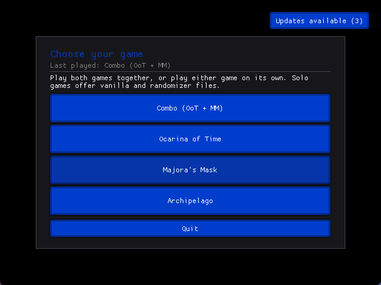
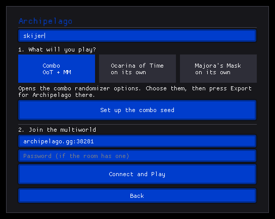
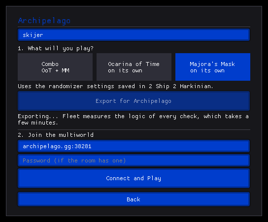
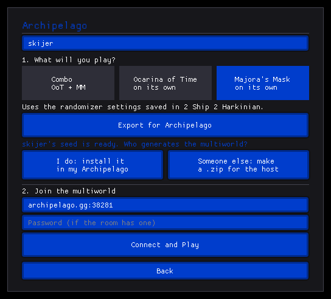
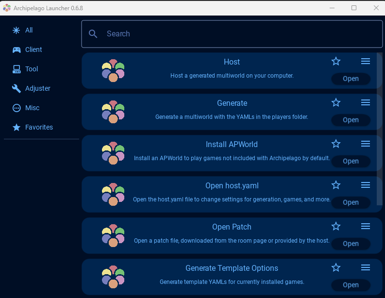

# Fleet

**Ocarina of Time + Majora's Mask. One randomizer.**

▶️ **[Watch the trailer](https://youtu.be/1HjUWtOB-K0)**

## 1. Install

**Download your zip below. Unzip it.**

**Open `fleet`. Pick both ROMs.**

**Wait. Games open and close.**

**Pick a mode. Play.**

| ROM | Works |
| --- | --- |
| Ocarina of Time | N64 NTSC 1.0 / 1.1 / 1.2 |
| Majora's Mask | N64 US / GameCube US |

## 2. Archipelago

**Choose Archipelago. Type your slot.**

**OoT or MM: press Export.**

**Combo: set options, then Export.**

**Wait a few minutes.**

**Pick who generates.**

### You generate

**Press "I do". Open Archipelago. Generate.**

### Someone else generates

**Press "Someone else". Send the zip.**

**Host unzips it into Archipelago.**

### Play

**Enter server and password. Connect.**

## Problems?

- **ROM refused?** Check the table.
- **Files failed?** Send the named log.
- **"Not responding"?** Wait. It's working.
- **Updating?** Use the Updates button.
- **Windows:** needs the [VC++ runtime](https://aka.ms/vs/17/release/vc_redist.x64.exe).
- **Mac Archipelago:** run `brew install openssl@3`.
- **Linux file picker missing?** Install `zenity`.
